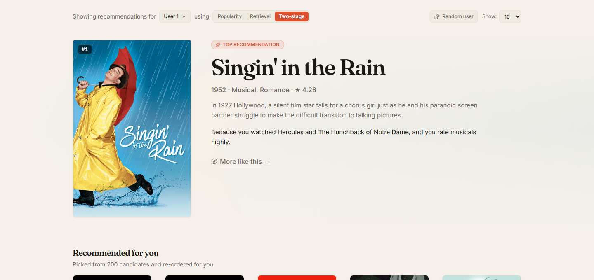
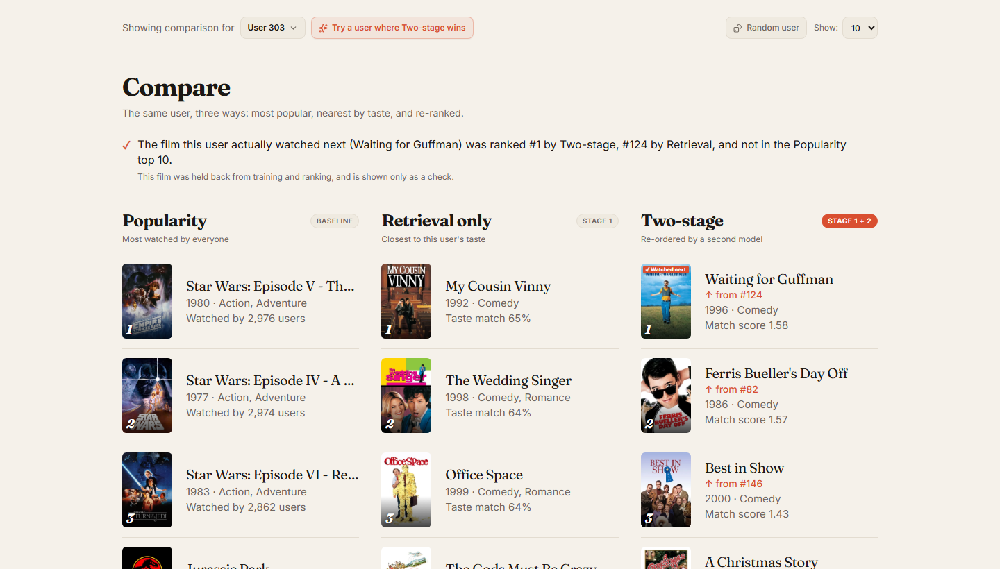
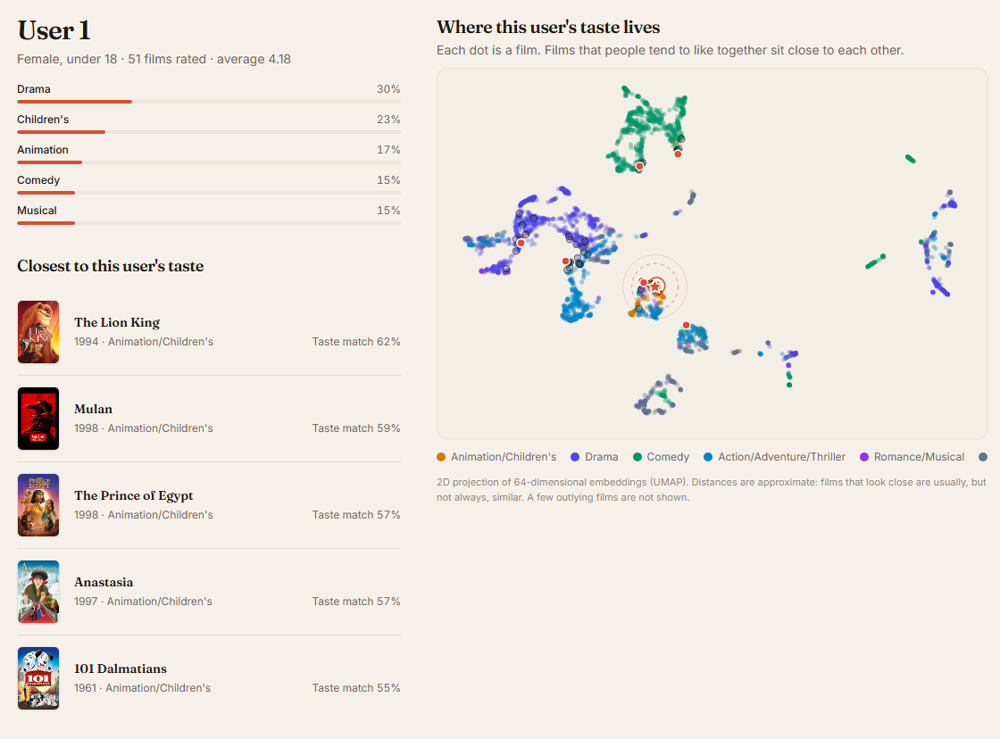
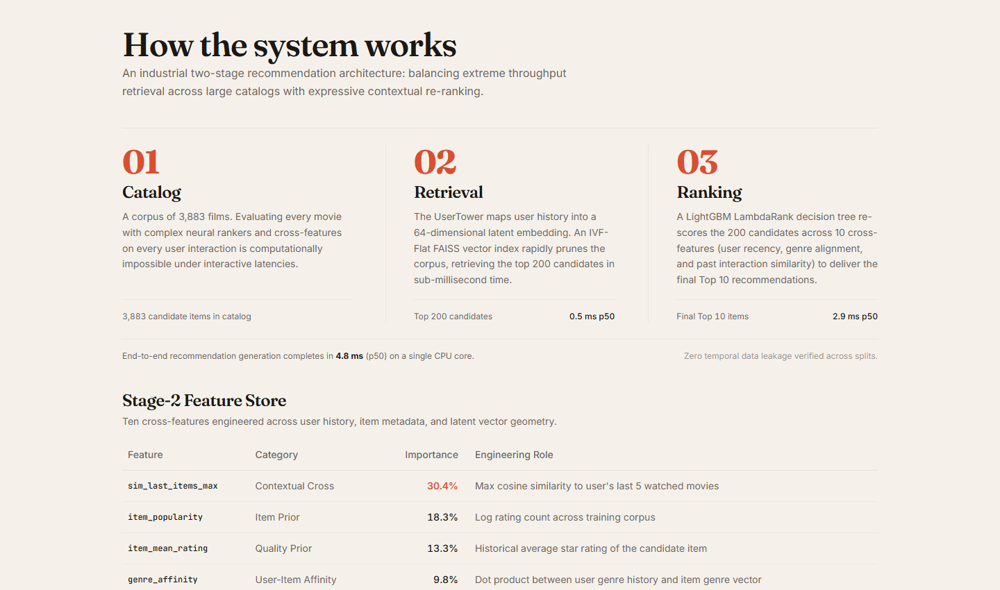

# RecStage: Two-Stage Movie Recommender

A movie recommendation system on MovieLens 1M. It retrieves candidates with a two-tower neural network and a FAISS index, then re-ranks them with LightGBM LambdaRank. A React web app lets you try it and compare the stages side by side.

**Live Demo:** https://recstage-two-stage-recommender.vercel.app/

The first request can take 45 to 60 seconds, because the free backend sleeps when idle.

| Recommend | Compare (3 stages side by side) |
| :---: | :---: |
|  |  |

| Taste Map (2D embeddings) | How It Works |
| :---: | :---: |
|  |  |

---

## How it works

1. **Stage 1: Retrieval.** A user tower and an item tower map users and movies into a shared 64-dimensional space. FAISS finds the 200 closest movies out of 3,883.
2. **Stage 2: Ranking.** LightGBM LambdaRank re-orders those 200 using 10 features, such as item popularity, genre affinity, similarity to the user's recent movies, and the Stage 1 rank.

The whole pipeline takes about 3.3 ms per user (p50).

---

## Results

Evaluated on 3,563 test users with a leave-last-out split. Each user's final rating is held out, and neither training nor the index ever sees it. Recall@10 and Hit@10 are the same here because each user has one held-out movie.

| Model | Recall@10 | Recall@50 | Recall@100 | NDCG@10 | p50 latency |
| :--- | :---: | :---: | :---: | :---: | :---: |
| Popularity | 4.77% | 17.79% | 27.59% | 0.0222 | 0.06 ms |
| Matrix Factorization (BPR) | 6.71% | 23.29% | 35.45% | 0.0315 | 0.71 ms |
| Two-Tower + FAISS | 16.22% | 38.76% | 50.69% | 0.0838 | 0.54 ms |
| **Two-Stage (Two-Tower + Ranker)** | **16.84%** | **39.55%** | **51.45%** | **0.0859** | 3.29 ms |

The two-stage system gets about 3.5x the Recall@10 of the popularity baseline and about 2.5x that of matrix factorization.

### Honest notes

- **The ranker's gain is small.** Two-Stage beats Two-Tower by +0.6 points of Recall@10 and +0.002 NDCG@10. A paired bootstrap (1,000 resamples) gives 95% confidence intervals that include zero, so this gain is not statistically significant.
- **Most of the ranker's weight is the Stage 1 rank.** `stage1_rank_inv` carries 71.5% of the feature importance. The next largest are `sim_last_items_max` (5.4%) and `item_popularity` (5.1%).
- **Ablations did not beat the full ranker by much.** Removing the similarity features or the user features gives scores close to the full ranker, and slightly higher on some metrics.
- **A ranker bug was found and fixed.** An earlier version scored far below retrieval alone (NDCG@10 0.0072). The cause was a training bug: relevant movies missed by Stage 1 were appended to the end of the candidate list, and previously watched movies were labeled as positives. The fix was to build training groups the same way as at inference time, use time-based cutoffs per user, use graded relevance from ratings, and use a separate validation set for early stopping.
- **Cold-start users score higher.** Users with 34 or fewer training ratings (760 users) get NDCG@10 of 0.102. Their held-out movies tend to be popular titles, which are easier to predict.

---

## Run locally

**Windows (PowerShell):**
```powershell
.\scripts\dev.ps1
```

**macOS / Linux:**
```bash
make dev
```

This starts the frontend at http://localhost:5173 and the API at http://127.0.0.1:8000 (API docs at `/docs`).

To start them separately:
```bash
uvicorn api.main:app --port 8000      # terminal 1
cd frontend && npm run dev            # terminal 2
```

If the frontend shows "Failed to reach recommendation API", the backend is not running. Check it with `curl http://127.0.0.1:8000/api/health`. If port 8000 is blocked on Windows, run the backend on 8001 and update the proxy target in `frontend/vite.config.js`.

To retrain from scratch: `make install`, `make data`, `make train`, `make evaluate`.

---

## Deployment

Both parts run on free tiers.

- **Backend:** Render free web service, built from the included `Dockerfile` (Python 3.12). Free instances sleep after 15 minutes without traffic, so the first request after that can take 45 to 60 seconds.
- **Frontend:** Vercel. Set the root directory to `frontend` and the framework to Vite.

Environment variables:

| Variable | Where | Purpose |
| :--- | :--- | :--- |
| `VITE_API_URL` | Vercel | Your Render backend URL, with no trailing slash |
| `CORS_ORIGINS` | Render | Allowed frontend origins (default `*`) |
| `TMDB_API_KEY` | local only | Only for re-running `scripts/fetch_posters.py` |

---

## Project structure

```text
├── api/            FastAPI service
├── artifacts/      Trained model, FAISS index, embeddings
├── data/           Poster data and 2D embedding map
├── frontend/       React 19 + Vite + Tailwind CSS
├── ml/             Data prep, models, features, training, evaluation, 35 tests
├── results/        metrics.json (all benchmark numbers above)
├── scripts/        Dev launcher and poster fetcher
└── Dockerfile
```

---

## Limitations

- **Old catalog.** MovieLens 1M only has movies up to the year 2000.
- **Brand-new users and movies are not handled.** The evaluation covers users with some history. Zero-history users and unseen movies would need content-based features, such as text embeddings of movie descriptions.
- **One objective.** The ranker only optimizes rating-based relevance, not clicks or watch time.

---

## Credits

- [MovieLens 1M](https://grouplens.org/datasets/movielens/1m/) from GroupLens Research.
- Poster images from TMDB. This product uses the TMDB API but is not endorsed or certified by TMDB.

## License

MIT
