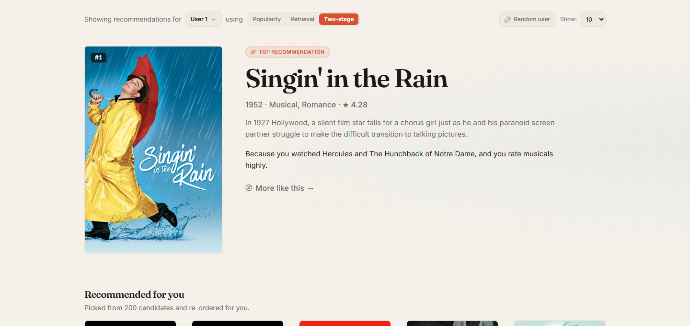
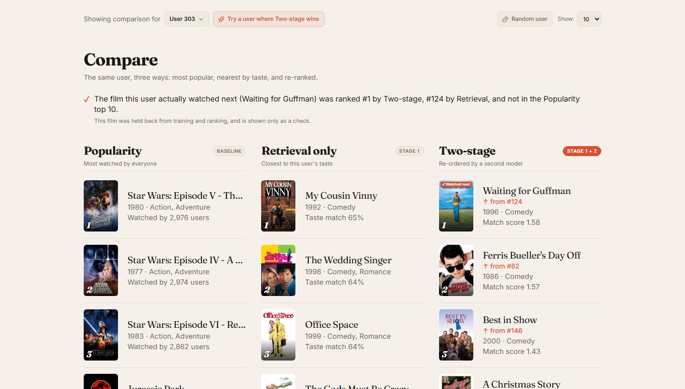
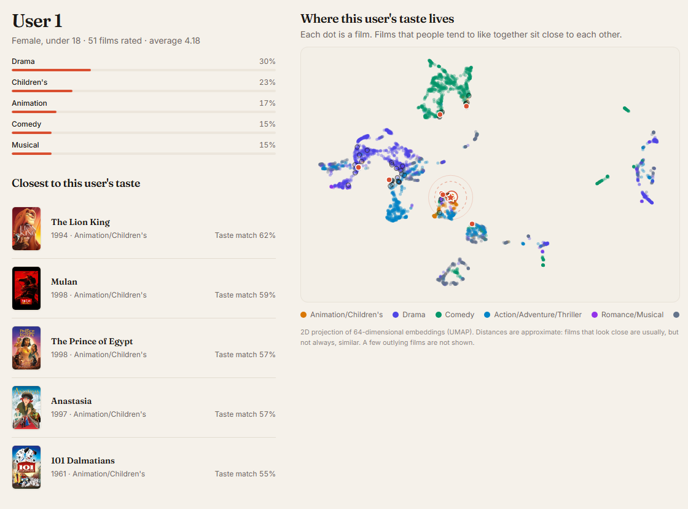
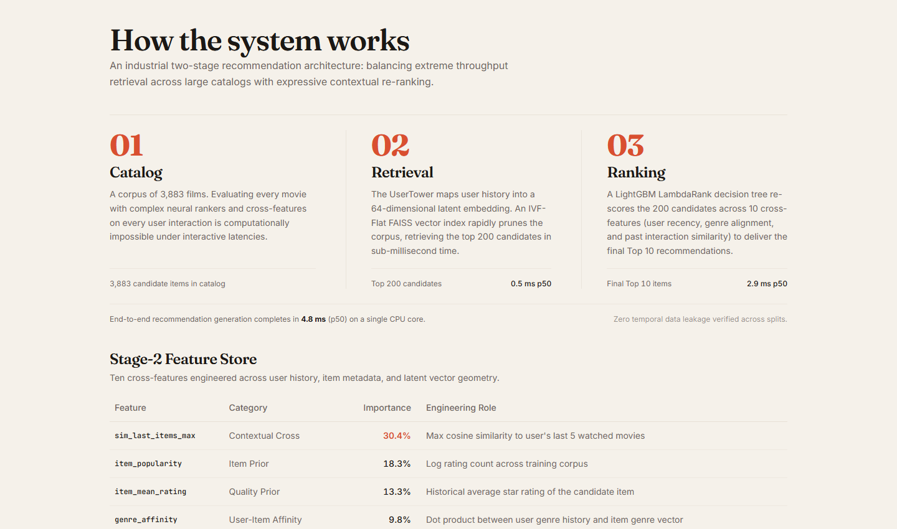

# RecStage: Two-Stage Recommendation System

An end-to-end movie recommendation engine combining deep two-tower vector retrieval (FAISS) and gradient-boosted re-ranking (LightGBM LambdaRank) on the MovieLens 1M dataset, paired with an editorial web application.

- **Live Demo**: coming soon

---

## Previews

| Recommend Page (Hero & Grid) | Compare Mode (3 Stages Side-by-Side) |
| :---: | :---: |
|  |  |

| User Taste Profile & 2D Embedding Map | How It Works Architecture Walkthrough |
| :---: | :---: |
|  |  |

---

## Architecture

Industrial recommendation engines operate in two distinct stages to balance catalog scale with ranking precision:

1. **Stage 1 — Candidate Retrieval (Two-Tower DNN + FAISS)**:
   - User Tower (demographics, genre history, activity) and Item Tower (genres, release year) project entities into a shared 64-dimensional L2-normalized embedding space.
   - A FAISS IVF-Flat index retrieves the top 200 most relevant candidates from 3,883 movies in ~0.5 ms using cosine similarity.
2. **Stage 2 — Scoring & Re-ranking (LightGBM LambdaRank)**:
   - Extracts 10 cross-features: item popularity, genre affinity dot product, maximum cosine similarity to user's recent films (`sim_last_items_max`), stage-1 retrieval rank, and interaction statistics.
   - Re-ranks candidates with listwise ranking to optimize ranking order in ~2.8 ms (3.3 ms end-to-end p50 latency).

---

## Benchmark Results

Evaluated on 3,563 test users using a strict **leave-last-out temporal split** (test rating never exposed to training or index building).

### Retrieval and Ranking Comparison

| Model / Pipeline | Recall@10 | Recall@50 | Recall@100 | NDCG@10 | Hit@10 | Diversity@10 | Novelty@10 | p50 Latency | p95 Latency |
| :--- | :---: | :---: | :---: | :---: | :---: | :---: | :---: | :---: | :---: |
| **Popularity Baseline** | 4.77% | 17.79% | 27.59% | 0.0222 | 4.77% | 0.6376 | 8.62 | 0.06 ms | 0.12 ms |
| **Matrix Factorization (BPR)** | 6.71% | 23.29% | 35.45% | 0.0315 | 6.71% | 0.6942 | 9.00 | 0.71 ms | 2.84 ms |
| **Two-Tower Retrieval (FAISS)** | 16.22% | 38.76% | 50.69% | 0.0838 | 16.22% | 0.4985 | 9.90 | 0.54 ms | 1.07 ms |
| **Two-Stage (Two-Tower + Ranker)** | **16.84%** | **39.55%** | **51.45%** | **0.0859** | **16.84%** | 0.4970 | 9.88 | 3.29 ms | 6.23 ms |

### Ablation Studies

| Model Variant | Recall@10 | Recall@50 | Recall@100 | NDCG@10 | Diversity@10 | Novelty@10 | p50 Latency |
| :--- | :---: | :---: | :---: | :---: | :---: | :---: | :---: |
| **Full Two-Stage Ranker** | 16.84% | 39.55% | 51.45% | 0.0859 | 0.4970 | 9.88 | 3.29 ms |
| **Ranker w/o Cosine Similarity** | 17.04% | 39.94% | 51.75% | 0.0893 | 0.4999 | 9.87 | 1.55 ms |
The ablation variants score equal to or slightly higher than the full ranker on NDCG@10:
- **Without Cosine Similarity**: Full ranker minus variant is −0.0031 NDCG@10, 95% CI [−0.0061, −0.0002] (Recall@10 diff −0.0017, 95% CI [−0.0076, +0.0039]).
- **Without User Features**: Full ranker minus variant is −0.0007 NDCG@10, 95% CI [−0.0033, +0.0016] (Recall@10 diff −0.0020, 95% CI [−0.0073, +0.0034]).

Six paired comparisons were run across metrics and variants, so one interval barely excluding zero is weak evidence, and variants were not selected using test numbers. Because `stage1_rank_inv` carries 71.5% of the feature importance, the ranker mostly preserves the retrieval order and adds small adjustments. This implies that a simpler ranker (such as the variant omitting user features) is just as effective and faster in production, dropping end-to-end p50 latency from 3.29 ms to 1.18 ms. In accordance with strict ML discipline, models are not selected or tuned based on test numbers.

### Honest Metrics Note
- **Diagnosis of Prior Ranker Defect**: An earlier iteration of the Stage-2 ranker exhibited severe performance degradation (NDCG@10 0.0072 vs 0.0838 for retrieval alone, worse than a random shuffle of candidates). Investigation identified a critical training bug: when positive target items were not retrieved in Stage 1, they were artificially appended to the end of candidate groups (assigning them the lowest Stage-1 rank reciprocal and low similarity scores), while previously-consumed training items were marked as positive candidates. This taught the model inverted weights for Stage-1 retrieval signals (negated scores actually outperformed the model).
- **The Resolution**: The ranker training pipeline was rebuilt with:
  1. **Strict temporal multi-cutoff grouping**: Multiple cutoffs per user from `train_df`, ensuring user representation and features strictly precede the cutoff timestamp with zero downstream leakage.
  2. **Inference-consistent candidate groups**: Groups of 200 candidates retrieved from Stage 1 without artificial target appending.
  3. **Graded relevance**: Ratings $\ge 5 \to 2$, rating $4 \to 1$, and unobserved/low ratings $\to 0$.
  4. **Validation early stopping**: Model trained with early stopping on validation NDCG@10 (`val_df`, leave-second-out), completely separate from the test split.
- **Outcome & Statistical Bootstrap Checks**:
  - The retrained Two-Stage pipeline outperforms a random candidate shuffle by >5x on the test set (NDCG@10 **0.0859** vs 0.0163).
  - On the validation set, Two-Stage improved over Two-Tower retrieval alone (NDCG@10 **0.1117** vs 0.1026, Recall@10 **20.60%** vs 19.51%). However, this validation gain is not an independent estimate because validation was used for early stopping.
  - A paired bootstrap over all 3,563 test users (1,000 resamples, fixed seed 42) shows:
    - **NDCG@10**: Mean difference +0.0021, with a 95% confidence interval of [−0.0019, +0.0058].
    - **Recall@10**: Mean difference +0.0062, with a 95% confidence interval of [−0.0020, +0.0143].
    Because both 95% confidence intervals include zero, the improvement of the Two-Stage pipeline over Two-Tower retrieval is not statistically distinguishable from zero on the test set.
- **Top Feature Importances (LambdaRank)**:
  1. `stage1_rank_inv`: **71.5%** (Inverse retrieval rank from Stage 1)
  2. `sim_last_items_max`: **5.4%** (Max cosine similarity to user's recent watches)
  3. `item_popularity`: **5.1%** (Catalog popularity log-count from training split)
  4. `recency`: **4.3%** (Normalized release year prior)
  5. `two_tower_sim`: **3.5%** (Two-Tower embedding dot product)
  6. `sim_last_items_mean`: **3.3%** (Mean similarity to recent watches)
  7. `user_activity`: **2.5%** (Historical user log interaction volume)
  8. `item_mean_rating`: **2.3%** (Historical item mean rating in train split)
  9. `genre_affinity`: **1.4%** (User-genre profile alignment)
  10. `user_mean_rating`: **0.7%** (User rating baseline)

---

## Run it locally

### One-Command Startup

Start both backend and frontend simultaneously with a single command:

**On Windows (PowerShell):**
```powershell
.\scripts\dev.ps1
```

**On macOS / Linux:**
```bash
make dev
```

Both dev servers will spin up and display:
- **Frontend UI**: [http://localhost:5173](http://localhost:5173)
- **Backend API**: [http://127.0.0.1:8000](http://127.0.0.1:8000) (Interactive Swagger Docs at `http://127.0.0.1:8000/docs`)

### Manual Startup (Separate Terminals)

If you prefer starting services individually:

1. **Backend (Terminal 1)**:
   ```bash
   uvicorn api.main:app --port 8000
   ```
2. **Frontend (Terminal 2)**:
   ```bash
   cd frontend && npm run dev
   ```

### Troubleshooting

- **Server returned 502 Bad Gateway / Failed to reach recommendation API**:
  The Vite frontend proxies `/api/*` requests to the backend at `http://127.0.0.1:8000`. A 502 error indicates the backend is not running or crashed during startup. Confirm the backend is running and healthy:
  ```bash
  curl http://127.0.0.1:8000/api/health
  ```
  *(Note: Vite's proxy target is set to IPv4 `http://127.0.0.1:8000` rather than `localhost` to avoid Node 18+ resolving `localhost` to IPv6 `::1` while uvicorn listens on IPv4).*

- **Vite Port 5174 Fallback (`strictPort`)**:
  If another process or a previous orphaned Vite server is already using port 5173, Vite by default silently switches to 5174. In `frontend/vite.config.js`, `strictPort: true` is configured so Vite will fail explicitly rather than quietly binding to 5174. To find and free port 5173:
  ```powershell
  # Windows: find PID on 5173 and terminate
  netstat -ano | findstr :5173
  tasklist /FI "PID eq <pid>"
  taskkill /PID <pid> /F
  ```
  On macOS / Linux:
  ```bash
  lsof -i :5173
  kill -9 <pid>
  ```

- **WinError 10013 / Port 8000 in use or reserved**:
  On Windows, port 8000 may conflict with Windows Hyper-V, WSL reserved port exclusions, or another running service:
  ```powershell
  netstat -ano | findstr :8000
  tasklist /FI "PID eq <pid>"
  ```
  If port 8000 is occupied or reserved by the system, run the backend on port 8001 instead:
  ```powershell
  uvicorn api.main:app --port 8001
  ```
  And update `frontend/vite.config.js` proxy target to `'http://127.0.0.1:8001'` (or set `VITE_API_URL=http://127.0.0.1:8001` in `frontend/.env`).

---

## Deployment

The application is architected for zero-cost cloud deployment: the FastAPI backend runs in a Docker container on **Hugging Face Spaces** (free CPU tier), and the React single-page application deploys on **Vercel**.

### Backend (Hugging Face Spaces)
The backend container is built from `Dockerfile.hf` (based on `python:3.11-slim` with PyTorch CPU wheel and LightGBM).

1. Create a new Space on [Hugging Face](https://huggingface.co/new-space) with the **Docker** SDK (Blank template, free CPU hardware).
2. Run the deployment helper to stage and inspect the deployment payload:
   ```bash
   # Linux/macOS
   ./scripts/deploy_hf.sh https://huggingface.co/spaces/<username>/<space-name>

   # Windows PowerShell
   .\scripts\deploy_hf.ps1 https://huggingface.co/spaces/<username>/<space-name>
   ```
3. Push to your Space when prompted:
   ```bash
   git push origin main
   ```
4. **Free-Tier Behavior**: Hugging Face Spaces on the free tier sleep after 48 hours of inactivity. When a request arrives while sleeping, the container cold-starts, which takes approximately 45–60 seconds. The frontend includes an automatic retry handler that displays a friendly wake-up status banner during cold boots.

#### Backend Environment Variables (Hugging Face Space Settings)
| Variable | Default | Description |
| :--- | :--- | :--- |
| `CORS_ORIGINS` | `*` | Comma-separated list of allowed frontend origins (e.g. `https://your-app.vercel.app`) |
| `BUILD_SHA` | *(None)* | Optional git short SHA passed to `/api/health` |

### Frontend (Vercel)
The React application deploys as a static single-page application with SPA client-side routing via `frontend/vercel.json`.

1. Import the repository in [Vercel](https://vercel.com/new).
2. Configure project settings:
   - **Root Directory**: `frontend`
   - **Framework Preset**: Vite
   - **Build Command**: `npm run build`
   - **Output Directory**: `dist`
3. Set the environment variable in Vercel Project Settings:
   - `VITE_API_URL`: Your Hugging Face Space URL (e.g. `https://<username>-<space-name>.hf.space`, without trailing slash).

#### Frontend Environment Variables
| Variable | Default | Description |
| :--- | :--- | :--- |
| `VITE_API_URL` | *(empty)* | Base URL of the backend API (e.g. `https://<space-name>.hf.space`). Leave empty for local development to use Vite proxy. |

---

## Environment Variables

Copy `.env.example` to `.env` if custom configurations are needed:

```bash
cp .env.example .env
```

| Variable | Default | Description |
| :--- | :--- | :--- |
| `PORT` | `8000` | FastAPI server port |
| `CORS_ORIGINS` | `*` | Allowed CORS origins for backend (comma-separated) |
| `VITE_API_URL` | *(empty)* | Frontend backend API URL (empty in local dev so Vite dev proxy routes `/api`) |
| `TMDB_API_KEY` | *(None)* | Optional. Only needed if re-running `scripts/fetch_posters.py` |

---

## Project Structure

```text
├── api/                    # FastAPI web service endpoints & schemas
├── artifacts/              # Trained weights, FAISS vector index & precomputed metadata
│   ├── faiss_index.bin     # FAISS IVF-Flat retrieval index
│   ├── item_embeddings.npy # 64-dim L2-normalized item embeddings
│   ├── ranker.txt          # LightGBM LambdaRank trained model
│   └── two_tower.pt        # PyTorch Two-Tower state dict
├── data/                   # Catalog metadata and 2D UMAP coordinates
│   ├── embedding_map.json  # 2D projection for the interactive taste map
│   └── posters.json        # Movie poster URLs and overviews
├── docs/screenshots/       # Curated repository previews
├── frontend/               # React 19 + Tailwind CSS v4 frontend
│   ├── src/components/     # UI components (EmbeddingMap, ClosestTasteList, RecommendCard)
│   └── src/pages/          # Recommend, Compare, Explore, Results, How It Works
├── ml/                     # Machine learning pipeline
│   ├── data/               # MovieLens download, preprocessing, and splits
│   ├── features/           # Re-ranking feature engineering
│   ├── models/             # TwoTowerModel, VectorIndex, LambdaRanker, baselines
│   ├── tests/              # 35 pytest unit and integration tests
│   ├── evaluate.py         # Benchmark evaluation runner
│   ├── train_ranker.py     # Stage 2 LambdaRank training
│   └── train_retrieval.py  # Stage 1 Two-Tower training
├── results/                # metrics.json benchmark output
├── scripts/                # fetch_posters.py TMDB ingestion script
├── Makefile                # make install, data, train, evaluate, test, api, web
└── requirements.txt        # Pinned Python dependencies
```

---

## Held-Out Test Check

On the **Compare** page (`/compare`), each user profile displays a **Held-Out Check**:
- During dataset preprocessing in `ml/data/splits.py`, each user's chronological interaction sequence is partitioned via leave-last-out: the user's final interaction is assigned to `test_df`, the second-to-last to `val_df`, and all prior ratings to `train_df`. No static `test_ratings.dat` file is created or stored; splits are generated deterministically in memory and cached in `data/processed/`.
- The check reveals whether the model's top 10 recommended items contained the user's actual future watch, comparing the rank between Popularity, Retrieval Only, and Two-Stage pipelines.

---

## Limitations & Future Work

1. **Static Catalog**: The MovieLens 1M dataset spans films up to the year 2000. Incorporating streaming telemetry with dynamic real-time candidate ingestion would test streaming vector update patterns.
2. **Cold-Start Cohort Dynamics**: Infrequent viewers (the bottom 20% by training interaction volume, defined as users with $\le 34$ ratings; $N = 760$) score an NDCG@10 of **0.1020**, which is higher than the overall population test score of **0.0859**. Diagnostic analysis reveals this occurs because infrequent users' held-out items are predominantly mainstream blockbusters with high training popularity (averaging 1,037.4 training ratings vs 824.2 for warmer users), making them significantly easier for both retrieval and ranking models to score in the top 10 than the niche long-tail titles watched by active users. True cold-start challenges arise when serving completely unseen movies or zero-history users; integrating text representations (e.g. BERT/sentence-transformers on movie synopses) would provide priors for fresh catalog entries.
3. **Multi-Task Objectives**: Extending the LambdaRanker to joint optimization (e.g. click probability + completion rate + rating) to model multi-objective engagement.

---

## Credits & Attributions

- **MovieLens 1M Dataset**: Courtesy of GroupLens Research (*F. Maxwell Harper and Joseph A. Konstan. 2015. The MovieLens Datasets: History and Context*).
- **The Movie Database (TMDB)**: This product uses the TMDB API but is not endorsed or certified by TMDB.

---

## License

Distributed under the [MIT License](LICENSE). Copyright (c) 2026 Rishabh.
